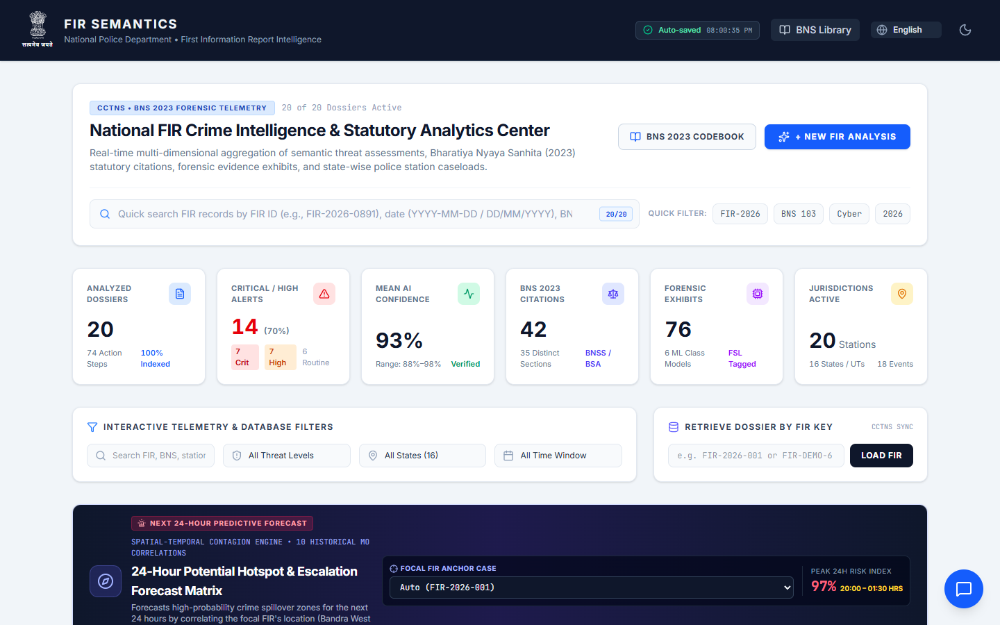
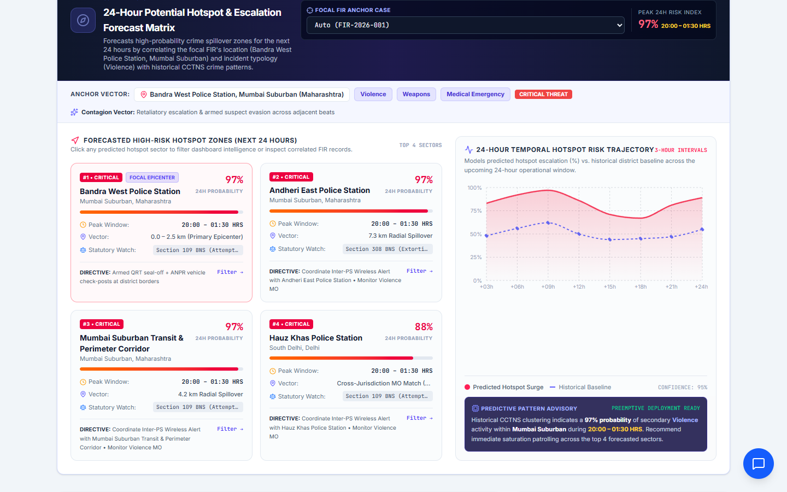
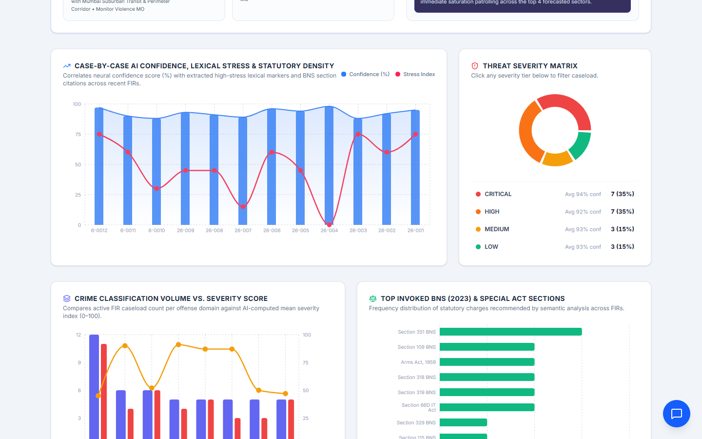
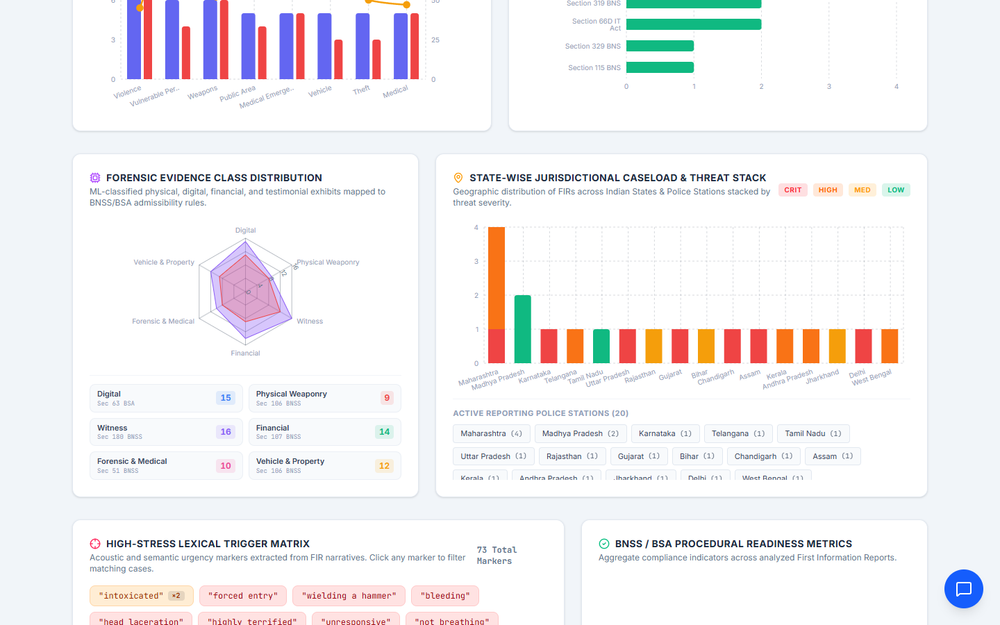
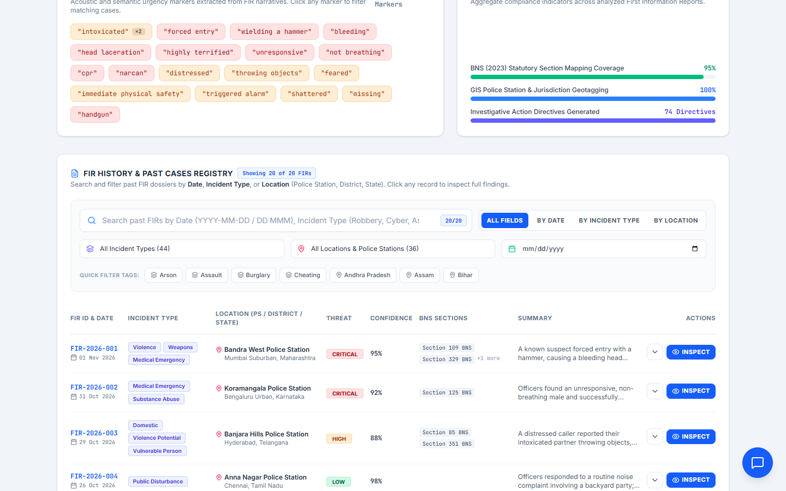
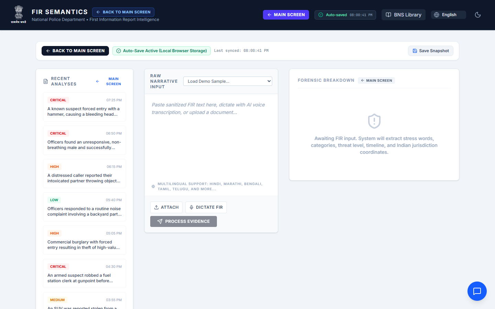
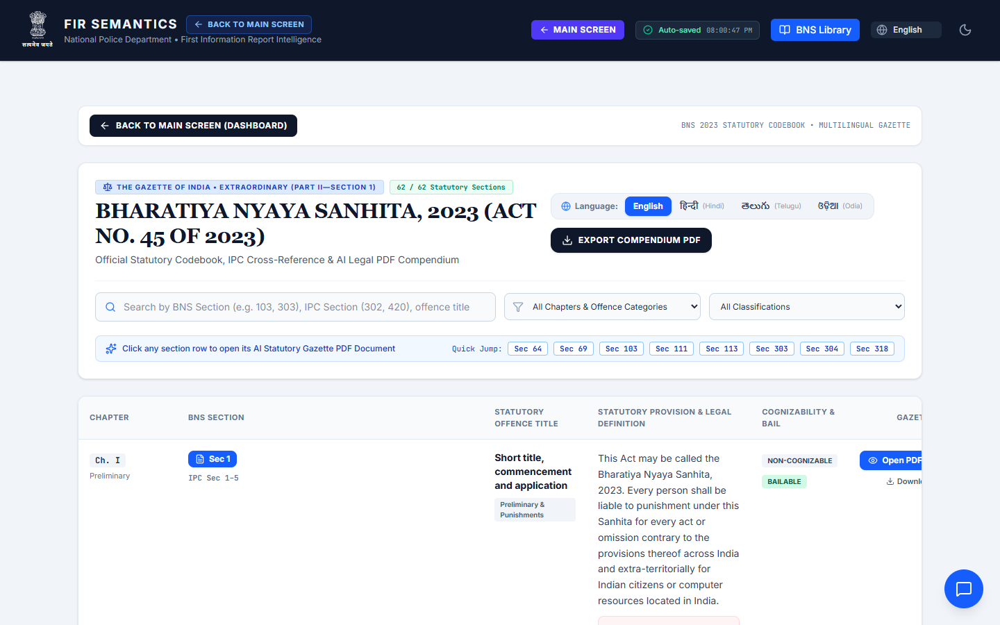

# FIR Semantics – Forensic FIR Analyzer

[](LICENSE)
[](https://render.com/deploy?repo=https://github.com/Uttpal-Tripathy/fir-analyzer)

An AI-powered tool for parsing First Information Reports (FIRs). It extracts threat levels, high-stress "trigger" words, incident categories, timelines, Indian jurisdiction details and recommended **Bharatiya Nyaya Sanhita (BNS) 2023** sections, then rolls every analysed case up into a crime-intelligence dashboard.

Built with React 19, Vite, Tailwind CSS, Recharts/D3 and an Express + WebSocket backend that talks to Google Gemini.

## Screenshots

### Crime intelligence dashboard


### 24-hour hotspot & escalation forecast


### Confidence, severity and BNS citation analytics


### Forensic evidence and state-wise caseload


### FIR history & past cases registry


### FIR analysis workspace


### BNS 2023 reference library


## Features

- **FIR analysis** – paste text, upload a document/image, or dictate by voice; get threat level, stress words, categories, timeline and BNS sections.
- **Multilingual** – English, Hindi, Marathi, Bengali, Tamil, Telugu, Gujarati, Kannada and Malayalam.
- **Dashboard** – KPIs, hotspot forecast, severity matrix, BNS citation frequency, evidence class radar, state-wise caseload, searchable FIR registry.
- **BNS 2023 library** – searchable statutory codebook with IPC cross-references and PDF export.
- **AI assistant** – chat and real-time voice conversation about the active FIR.
- **Auto-save** – workspace and history persist in the browser.

## Use it

| Option | How |
| --- | --- |
| **Website** | Deploy once to Render (below) and open your `https://<name>.onrender.com` URL from any device. |
| **Desktop (Windows)** | Download `FIR-Analyzer-<version>-portable.exe` from [Releases](https://github.com/Uttpal-Tripathy/fir-analyzer/releases) and double-click it – no install needed. It opens the hosted website in its own window. |
| **Local** | Run it on your own machine with Node.js (below). |

## Run locally

**Prerequisites:** Node.js 20+ and a [Gemini API key](https://aistudio.google.com/apikey).

```bash
npm install
# create .env.local containing:  GEMINI_API_KEY="your-key"
npm run dev
```

Open http://localhost:3000.

Production build:

```bash
npm run build
NODE_ENV=production npm start
```

## Deploy the website (Render, free)

1. Click **Deploy to Render** above (or in Render: *New → Blueprint* and pick this repo). The settings come from [`render.yaml`](render.yaml).
2. When asked, paste your `GEMINI_API_KEY`.
3. Wait for the build to finish – your site is live at `https://fir-analyzer.onrender.com` (or the name Render assigns).

Free Render services sleep after ~15 minutes of inactivity; the first visit afterwards takes about 30–60 seconds to wake up.

## Desktop app

The [`desktop/`](desktop) folder contains a small Electron wrapper around the hosted website.

```bash
cd desktop
npm install
npm start          # run it
npm run dist       # build dist/FIR-Analyzer-<version>-portable.exe
```

If your Render URL differs from `https://fir-analyzer.onrender.com`, edit [`desktop/config.json`](desktop/config.json) and rebuild. To point it at a local server temporarily, set `FIR_ANALYZER_URL=http://localhost:3000`.

## Environment variables

| Variable | Purpose |
| --- | --- |
| `GEMINI_API_KEY` | **Required.** Google Gemini API key used by the server. Never commit it. |
| `PORT` | Port to listen on (default `3000`; set automatically by Render). |
| `NODE_ENV` | `production` serves the built `dist/` instead of the Vite dev server. |

## License

[MIT](LICENSE) © 2026 Uttpal Tripathy
